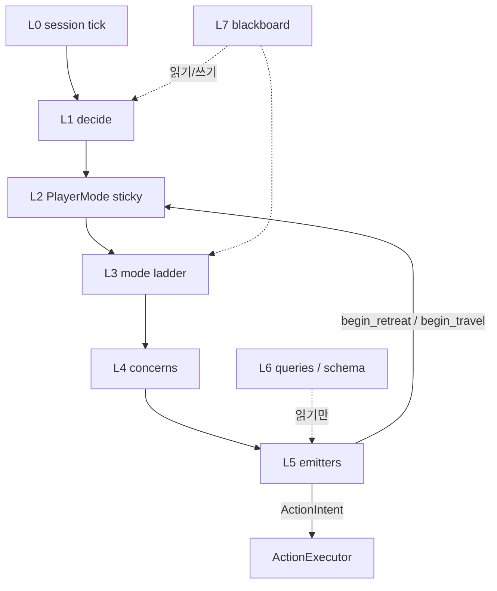

# Decision hierarchy — modes vs behaviors

## 0. 구조화 목표 (이 문서의 이유)

목표는 로직 완성이나 런타임 위험 감소가 **1순위가 아니다**.  
**맞물림이 뻔한 모듈 경계**를 만들어, 이후 수정·로직 보충·리뷰·동의 고지에 드는 **프로젝트 관리 비용**을 줄이는 것이다.

성공 기준:

- 새 요구가 오면 “어느 파일?”보다 먼저 **어느 층·어느 열·몇 번째 칸?**으로 위치가 정해진다.
- 한 칸을 고칠 때 **같이 깨질 수 있는 칸/모드**가 표로 보인다 (고지 문장이 자동에 가깝게 나온다).
- 모드 수는 적게, **재사용 칸(행동)** 은 이름 있게 — 복붙 사다리가 늘어나지 않는다.

라이브는 behavior tree가 아니다. **sticky `PlayerMode` + 모드별 행동 열(선착순)** 이다.  
파일 분할·레거시 삭제·사다리 로직 변경은 이 경계를 코드에 옮길 때의 일이다.  
코드와 충돌하면 [`mode_ticks.py`](../../Engine/app/_04_decision/behaviors/mode_ticks.py)와 [`decision_change_log.md`](../decision/decision_change_log.md)가 이긴다.

### 맞물림 모델 (목표 형태)

```text
PlayerMode          ← 소수 sticky 정책 (늘리지 않음)
  └── BehaviorColumn  ← 그 모드의 행동 칸 열 (선착순)
        └── Step        ← 이름 있는 L4/L5 단위 (한 주제·한 출구)
              └── Query ← L6 (표/후보만)
```

| 맞물림 | 규칙 |
| --- | --- |
| Mode → Column | 모드 하나당 열 하나 (던전은 farming 열의 variant, 별도 모드 아님) |
| Column → Step | 위→아래 선착순; 첫 emit/전환에서 틱 종료 |
| Step → Step | 같은 열 안 순서만 의존; 옆 모드 열을 직접 호출하지 않음 |
| Step → Mode | 전환은 L2 API만 (`begin_retreat` 등) |
| Step → Query | emit 금지인 L6만 읽음 |
| 공유 Step | HP·unstick·retreat처럼 여러 열에 끼워지는 칸 — **한 구현, 여러 열 참조** |

지금 `tick_farming` 등의 긴 함수는 **아직 열이 코드로 안 빠진 사다리**다. 구조화의 다음 작업은 그 사다리를 **이름 붙은 열 표 + 얇은 runner**로 옮기는 것이지, 모드 enum을 늘리는 것이 아니다.

---

## 1. 층 한눈에

위층이 아래층을 호출한다. 아래층은 위층의 모드를 마음대로 바꾸지 않는다 (전환은 L2 `mode_control`만).

| 층 | 이름 | 하는 일 | 대표 파일 |
| --- | --- | --- | --- |
| L0 | Session tick | 캡처·apply·decide·게이트·execute | `session/bot_controller` |
| L1 | Decide orchestrator | 틱 준비, `tick_mode` ≤3 handoff, IDLE 합성 | `manager.DecisionManager` |
| L2 | Sticky mode | 세션이 어느 **정책**에 있는지 | `PlayerMode`, `mode_control` |
| L3 | Mode ladder | 그 모드에서 **이번 틱 누가 이기는지** (선착순) | `mode_ticks` |
| L4 | Concerns | 사다리 한 칸: 상점·월드내비·수색·패트롤… | `shop_trip`, `world_nav`, `patrol`, … |
| L5 | Emitters | `ActionIntent`를 쏘거나 모드 전환을 요청 | `mode_actions`, `travel`, `loot_hop`, combat sticky |
| L6 | Queries / schema | “누구를 칠까”, HP 표, 종족 규칙 — **의도 안 쏨** | `combat_query`, `hp_actions`, `species_rules` |
| L7 | Memory | 틱 간 sticky + scratch | `blackboard` |
| (밖) | Action | 클릭·키 — decide 밖; `ActionType` 19종 + `ActionResult` | `_05_action` |



---

## 2. L2 — 모드 (정책 상태)

모드 ≠ 이번 틱의 `ActionType`. 모드가 `farming`이어도 intent는 `ATTACK`일 수 있다.

| `PlayerMode` | 정책 | 틱 함수 |
| --- | --- | --- |
| `RETREATING` | 전투 없이 회복·두루마리·안전 걷기 | `tick_retreating` |
| `SHOPPING` | 상점 트립 (scroll / 같은맵 walk / `STOP` / `SHOP_RUN`) | `tick_shopping` |
| `WORLD_NAV` | 맵 간 루틴 (walk / scroll / `GATE`) | `tick_world_navigating` |
| `TRAVELING` | 같은 맵 걷기 (목적 `travel_purpose`) | `tick_traveling` |
| `FARMING` | 사냥터 정책; 던전이면 내부 분기 | `tick_farming` → `_tick_dungeon_farming` |

- **던전은 모드가 아니다.** `is_dungeon_map()`일 때 farming 사다리의 다른 가지다.
- **월드 내비는 모드다.** `begin_world_nav` / 세션 arm이 `WORLD_NAV`로 올리고, 도착·유휴 시 farming으로 돌아온다. farming의 `nav.world`는 duration/need handoff만.
- **상점은 모드다.** `begin_shopping` / `tick_shop_trip`이 `SHOPPING`으로 올리고, 트립 clear 시 farming 또는 pending `need_world_nav`(after_shop)로 돌아온다. 상점 걷기는 `PlayerMode.TRAVELING`으로 넘기지 않는다.
- 전환 API: `mode_control` (`set_mode`, `begin_travel`, `begin_retreat`, …) + `world_nav.begin_world_nav` + `shop_trip.begin_shopping`.
- **world_nav I/O는 주입이다.** session이 `normalize_routine` + 맵 오버레이(`SCRATCH_MAP_OVERLAYS`)를 Start에 싣고, decision은 dict만 읽는다 (`session.probes` 직접 import 없음).
- `TRAVELING`일 때 **목적** (`PURPOSE_ENTER_FARM`, `PURPOSE_PATROL`, `PURPOSE_SAFE` 등)이 L4 행동을 고른다. 목적 ≠ 모드. 상점 walk의 `PURPOSE_SHOP`은 `SHOPPING` 안에서만 쓴다.

---

## 3. L3 — 모드 사다리 (정책 안 우선순위)

`tick_mode` 공통 접두:

1. 사망 → `RESPAWN` / wait
2. 레벨업 UI → `DISMISS_LEVEL_UP`
3. 현재 `PlayerMode`로 dispatch

그 모드 안에서는 **위에서 아래로 선착순**. 한 칸이 intent를 emit하면 틱 종료 (또는 handoff로 다른 모드 틱을 같은 decide 루프에서 한 번 더).

섬 `tick_farming` 골격 (상세 순서는 LOGIC_OVERVIEW §7):

```text
survival-ish (death, emergency TP, HP, MP, returns)
  → shop handoff → SHOPPING
  → world_nav handoff → WORLD_NAV (walk만 L5 loot/combat 허용)
  → support / buffs
  → confined escape (섬)
  → farm upkeep / map return
  → farm_loot_or_combat   ← L5
  → enter farm / search   ← L4/L5
```

후퇴 사다리는 **전투 L5를 부르지 않는다** (적 없을 때 루팅만).

---

## 4. L4 — Concerns (사다리 칸의 “주제”)

한 concern은 “언제 이 주제를 볼지”는 L3가 정하고, “무엇을 emit할지”는 L5에 맡긴다.

| Concern | 역할 | 주요 모듈 |
| --- | --- | --- |
| Survival / HP policy | 회복·후퇴 시작 | `mode_actions.apply_hp_*`, `mode_control.begin_retreat` |
| Shop trip | 필요 → 트립 → SHOP_RUN | `shop_trip`, `shops` |
| World nav | 맵 간 루틴·게이트·두루마리 | `world_nav/*`, `talking_scroll`, `live_map_pack` |
| Same-map travel | 홉·도착 | `travel`, `pathfinding`, `nav_config` |
| Farm / dungeon upkeep | 체류·순환·패트롤 | `farm_*`, `patrol`, `dungeon*` |
| Search | 농장 안 수색 | `search_hop`, `navigation` |
| Engage | 교전·루팅 조합 | `mode_actions.farm_loot_or_combat` |
| Unstick | 막힘·갇힘 (공유) | `unstick` — **여러 concern이 호출** |

공유 concern(`unstick`, HP, retreat)은 섬·던전·이동이 같이 탄다. 고칠 때는 동의 로그 대상.

---

## 5. L5 vs L6 — emit vs query

| | L5 Emitters | L6 Queries / schema |
| --- | --- | --- |
| 결과 | `blackboard.emit(ActionIntent)` 또는 모드 전환 요청 | bool / 후보 객체 / 표 |
| 예 | `continue_or_start_combat`, `emit_travel_hop`, `_execute_hp_action` | `nearest_attackable`, `pick_hp_action`, `ground_item_allowed` |
| 금지 | L6가 Intent를 쏘지 않음 | L5가 “후보 집합 규칙”을 다시 구현하지 않는 것이 목표 |

라이브 교전 질의의 정본은 `combat_query` (+ `species_rules`).  
`target_selector` / `build_*_node`는 라이브 L3에 연결되어 있지 않다 (계층 밖·레거시).

HP: **스키마** `hp_actions` (L6) / **실행** `apply_hp_actions` (L5).

---

## 6. L7 — Blackboard

- **Sticky**: `player_mode`, engage lock, nav path, farm tour, needs_*, retreat flags…
- **Per-tick I/O**: `intent`, 일부 scratch
- **Untyped bus**: `scratch` (shop_trip, world_nav session, retreat_for, …) — concern 간 계약은 문서/호출부로만 유지

---

## 7. 계층 규칙 (관리 비용을 낮추는 맞물림)

1. **모드 전환은 L2 API만.** 칸 안에서 `player_mode = …` 직접 대입 금지 방향.
2. **L3/Column은 순서만.** 좌표 클릭·DLL 읽기 금지 (읽기는 perception → state).
3. **L6는 emit 금지.** 표·필터·거리만.
4. **공유 Step** 변경 고지는 “이 칸을 참조하는 열 목록”으로 쓴다 (섬·던전·이동이 표에 보이게).
5. 새 요구 접수 순서: (1) 층 (2) 모드 열 (3) 칸 이름·위치 (4) 파일. 파일부터 고르지 않는다.
6. 모드를 늘려 문제를 풀지 않는다. 칸을 추가하거나 열 순서를 바꾼다.

---

## 8. 파일 ↔ 층 (현 배치, 목표 아님)

현재 파일이 층과 1:1이 아니다. 정리 시 이 표를 목표로 삼는다.

| 파일 | 주 층 | 비고 |
| --- | --- | --- |
| `manager.py` | L1 (+ 일부 act feedback) | feedback 쪽 피드백이 decide 패키지에 섞임 |
| `player_mode.py` | L2 enum + knob dump | 설정 값은 층이 아님 |
| `mode_control.py` | L2 | |
| `mode_ticks.py` | L3 (+ L4 호출) | |
| `mode_actions.py` | L5 (HP·engage) | |
| `shop_trip` / `world_nav` / `patrol` / … | L4 | |
| `combat_query` / `hp_actions` | L6 | |
| `blackboard` | L7 | |
| ~~`legacy/`~~ / ~~`build_*_node`~~ | — | 제거됨. `behavior_tree.Status`만 틱 결과 타입으로 유지 |

---

## 9. 관련 문서

- 칸 이름표 초안: [DECISION_STEPS.md](DECISION_STEPS.md)
- 이슈(틱 무한 IDLE): [ISSUE_idle_livelock.md](ISSUE_idle_livelock.md)
- 틱 사다리 상세: [LOGIC_OVERVIEW.md](LOGIC_OVERVIEW.md) §7–§11, §15
- 동의·변경 기록: [decision_change_log.md](../decision/decision_change_log.md)
- 폴더 역할: [LAYOUT.md](LAYOUT.md)
